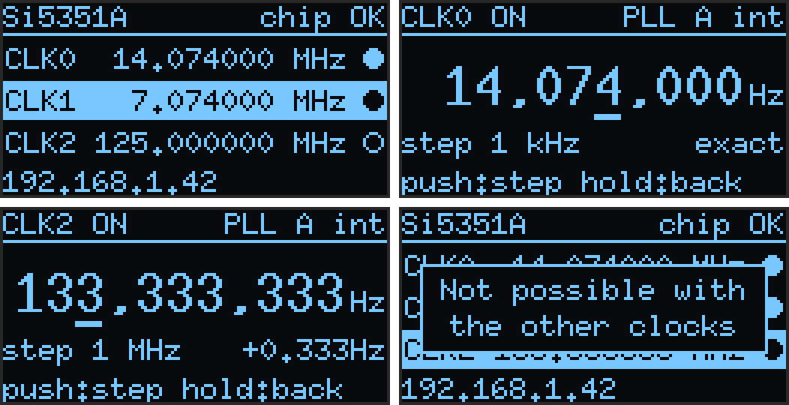

# Si5351A Web Clock Generator (NodeMCU V3 / ESP8266)

A web page, served by the NodeMCU, that sets CLK0, CLK1 and CLK2 of an Si5351A board to any frequency from **2.5 kHz to 200 MHz**. An optional front panel (128×64 I²C OLED + rotary encoder) lets you tune each clock by hand. The display and the web page stay in sync. Settings are saved in flash and restored at power-up.



## Wiring

| NodeMCU V3   | Si5351A board | OLED (I²C) | KY-040 encoder |
|--------------|---------------|------------|----------------|
| 3V3          | VIN / 3V3     | VCC        | +              |
| GND          | GND           | GND        | GND            |
| D2 (GPIO4)   | SDA           | SDA        |                |
| D1 (GPIO5)   | SCL           | SCL        |                |
| D5 (GPIO14)  |               |            | CLK            |
| D6 (GPIO12)  |               |            | DT             |
| D7 (GPIO13)  |               |            | SW             |

The Si5351A (address 0x60) and the OLED (0x3C or 0x3D, found automatically) share the I²C bus. Power the encoder from **3V3, not 5V**: its pull-ups connect to the ESP8266 pins, which are not 5 V tolerant. The display and encoder are optional; the sketch runs without them.

Most breakouts (Adafruit and the common purple clones) already include I²C pull-ups.

### Power

Power the NodeMCU through its **USB socket**, or with regulated **5 V on VIN**. Power the Si5351A, OLED and encoder from the NodeMCU's **3V3** pin, not 5 V. On the Adafruit board, 5 V on VIN would pull the I²C lines up to 5 V, and the ESP8266 pins are not 5 V tolerant.

> **Don't feed VIN through a standard silicon diode** (1N4001 etc.). Its ~0.65 V drop leaves about 4.3 V at VIN. That's too little for the board's AMS1117 regulator once Wi-Fi starts drawing current. The 3.3 V rail sags, the ESP8266 browns out and keeps resetting, and the web page, display and encoder all appear dead. For reverse-polarity protection, use a **Schottky diode** (1N5817/1N5819/SS14, ~0.3 V drop). The 3V3 pin should measure **3.2–3.4 V** while running. Use short leads, and terminate the RF outputs into 50 Ω if you need clean waveforms at high frequency.

## Build and upload

1. In the Arduino IDE, open **Preferences → Additional Boards Manager URLs** and add
   `https://arduino.esp8266.com/stable/package_esp8266com_index.json`. Then install **esp8266** from the Boards Manager.
2. In **Library Manager**, install **U8g2** (by oliver).
3. Open `Si5351_WebClock/Si5351_WebClock.ino` and select **NodeMCU 1.0 (ESP-12E Module)**.
4. Optional: set `WIFI_SSID` and `WIFI_PASS` at the top of the sketch. If you leave them empty, or the connection fails, the board starts its own access point: **Si5351-Clock**, password `si5351clk`, at http://192.168.4.1.
5. The sketch is set for a 1.3" SH1106 display (`#define OLED_SH1106 1`). For a 0.96" SSD1306, change it to `0`. If the text is shifted about 2 px left with stray dots on the right edge, it is set for the wrong type.
6. Upload, then open Serial Monitor at 115200 baud to see the IP address. On your own network you can also use **http://si5351.local**.

U8g2 is the only external library. The Si5351 driver is included.

## Front panel (OLED + encoder)

| Screen | Turn | Press | Hold (0.7 s) |
|---|---|---|---|
| Main (list of CLK0–2) | select a clock | edit it | turn that output on/off |
| Edit (one clock) | tune by the current step | next step size: 1 Hz → 10 Hz → … → 100 MHz | back to main |

- On the edit screen, the step digit is underlined. The header shows which PLL is in use and whether the divider is integer or fractional. The line below the frequency shows "exact" or the remaining error in Hz.
- Tuning a clock switches it on. If the new frequency can't coexist with the other two clocks, a "Not possible" message appears and the clock keeps its previous frequency.
- Changes take effect immediately. They're saved to flash 3 s after you stop turning, to spare the flash.
- Encoder direction or speed wrong? Set `ENC_REVERSE = true`, or change `ENC_STEPS_PER_DETENT` (4 suits most KY-040s; use 2 if it takes two clicks to move one step).

## Using the page

- Each clock card has an on/off switch, a frequency box (Hz/kHz/MHz), a drive-strength setting (2–8 mA) and quick presets.
- Each card shows the **frequency actually produced**, its error from your target, which PLL it uses, and the divider mode (integer / fractional / divide-by-4).
- **Calibration:** set CLK0 to 10 MHz and measure it with a frequency counter. Then enter `25000000 × measured / 10000000` as the crystal frequency and click **Save**.

## How the chip's limits are handled (`si5351_plan.h`)

| Constraint | Value |
|---|---|
| Output range | 2.5 kHz – 200 MHz |
| PLL VCO | 600–900 MHz, two PLLs (A, B) shared by three outputs |
| MultiSynth divider | 8–2048 fractional, or exactly 4 or 6 |
| Above 112.5 MHz | integer ÷6 (112.5–150 MHz) or ÷4 (150–200 MHz), so the VCO must equal exactly 4× or 6× the output |
| Below 500 kHz | R divider ÷2 … ÷128 is used |

The planner tries every way of assigning the enabled outputs to PLL A and B. For each PLL it picks a VCO that is an even multiple of one output, so that output gets a low-jitter integer divider; the other outputs on that PLL use fractional dividers. It keeps the arrangement with the smallest total error. Most combinations come out exact. In a 200,000-case random test, the worst error was 0.07 Hz. That worst case is an output above 112.5 MHz, whose fixed integer divider leaves only the PLL fraction to set the frequency.

Combinations the chip physically can't make are rejected with a message, and the outputs are left unchanged. Examples:
- three different outputs above 112.5 MHz that can't share a VCO;
- an output below about 3.4 kHz together with two outputs that each need a PLL above 870 MHz.

When a change moves a PLL, outputs on that PLL glitch briefly.

## Troubleshooting: hardware check

If the web page, display or encoder doesn't respond, upload `Si5351_Diag/Si5351_Diag.ino` (same board settings and U8g2 library). Then open the Serial Monitor at 115200 and press RST. It reports:
- the last reset reason (e.g. brownout)
- the 3.3 V supply voltage
- whether SDA/SCL idle high, and which I²C devices answer (Si5351A 0x60, OLED 0x3C/0x3D), including a check for swapped SDA/SCL
- whether Wi-Fi starts: it opens the access point **Si5351-Test**, with the report at http://192.168.4.1
- the encoder's readings, live, as you turn and press it

If the banner keeps repeating, the board is resetting. Check the power supply (see **Power** above).

## HTTP API

```
GET  /api/state                       -> JSON with settings, actual frequencies, PLL/divider details
GET|POST /api/set?f0=10000000&en0=1   -> apply; returns the same JSON, or {"ok":false,"error":...}
```
Parameters (send any subset): `f0 f1 f2` (Hz), `en0 en1 en2` (0/1), `d0 d1 d2` (drive mA: 2/4/6/8), `xtal` (Hz), `load` (6/8/10 pF).

```
curl "http://si5351.local/api/set?f0=14074000&f1=7074000&en1=1&f2=125000000&en2=1"
```

## Files

- `Si5351_WebClock.ino`: Wi-Fi, web server, settings storage
- `si5351_plan.h`: frequency planner and register encoding (plain C++, tested on PC)
- `si5351_hw.h`: I²C register driver
- `web_page.h`: the web UI
- `ui.h`: OLED screens and rotary-encoder handling
- `Si5351_Diag/Si5351_Diag.ino`: stand-alone hardware check
- `test/test_plan.cpp`: planner tests (`g++ -O2 -I../Si5351_WebClock test_plan.cpp && ./a.out`)
